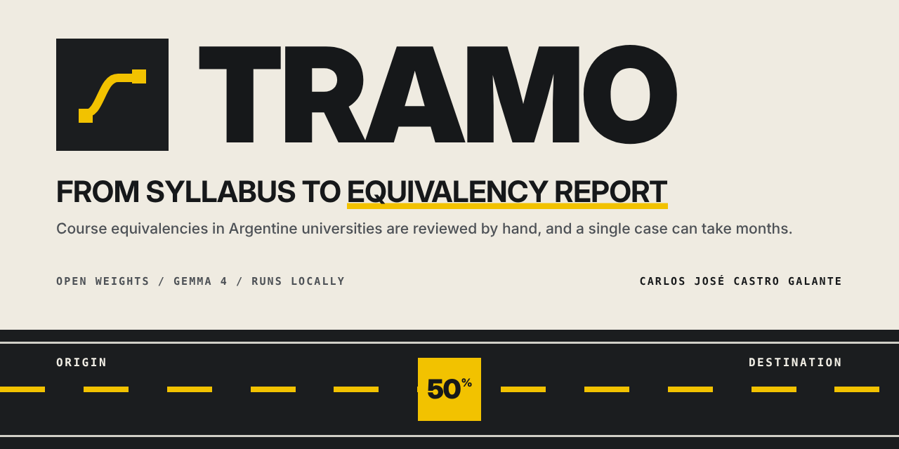
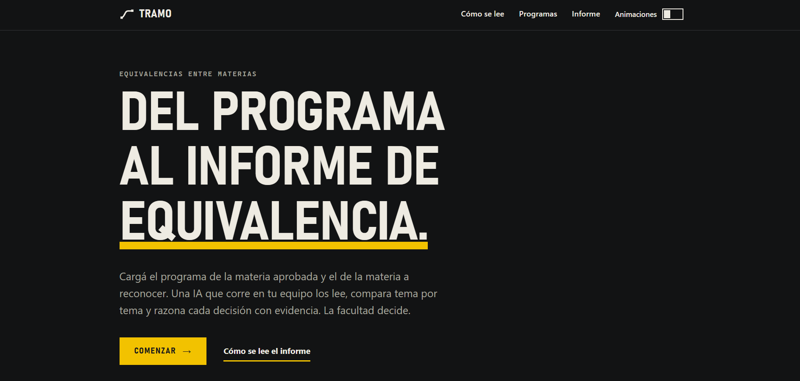
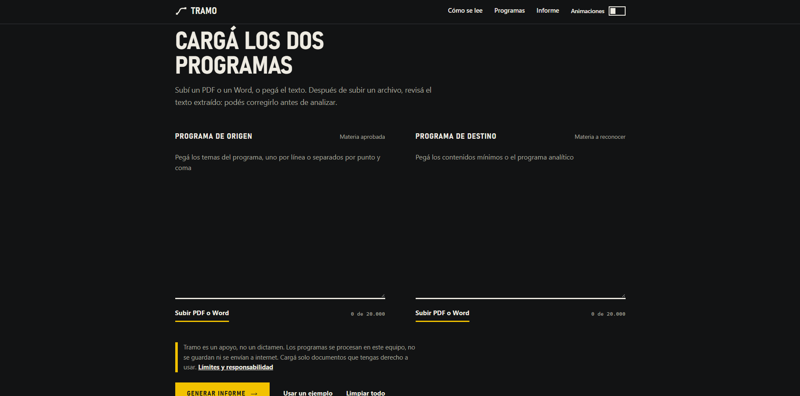
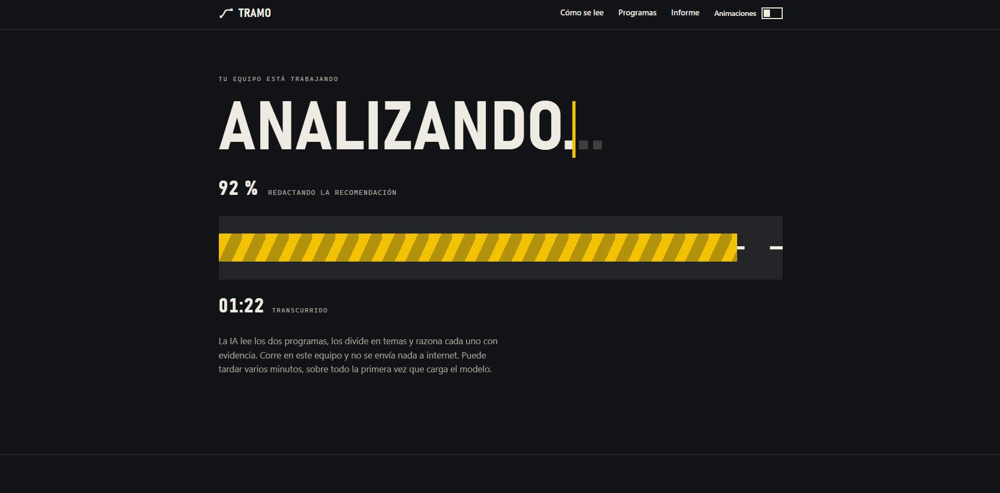
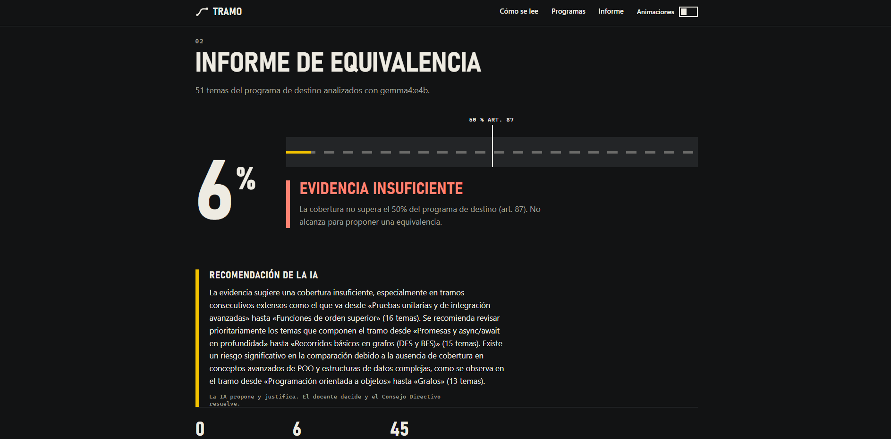
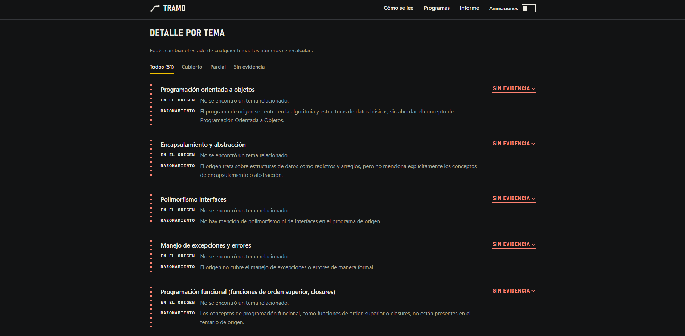
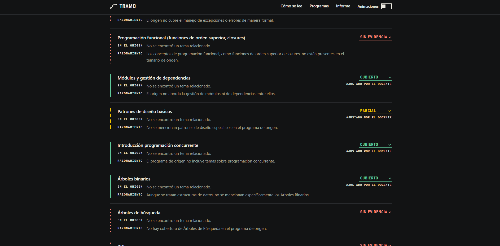
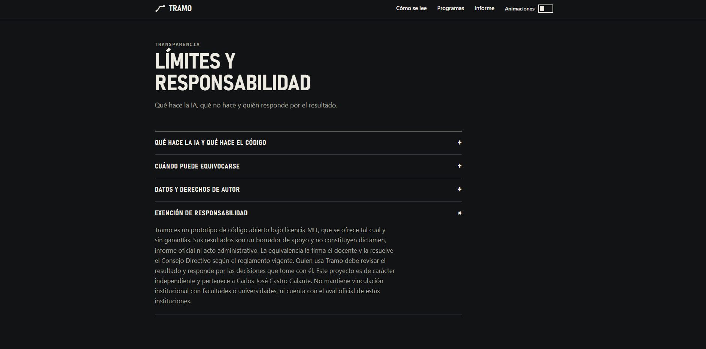

# Tramo



Tramo compares the analytic program of a subject a student has already passed with the program of the subject they want recognized, and drafts an equivalency report for the professor who reviews the case. It runs entirely on the computer of whoever uses it, with an open weights model served by Ollama, so the documents never leave the machine.

The software does not decide anything. The model proposes a status for every topic and explains its reasoning with evidence taken from the documents, plain code computes the coverage and applies the equivalency rule, and the professor remains free to overrule any single judgment before signing. The final resolution belongs to the university authorities.

The demo video is also available on [YouTube](https://youtu.be/E-zZ3ENiBgU).

## The problem it addresses

Universities in Argentina and across Latin America resolve equivalencies by hand, and a single case often takes many months. The reviewing professor has to read two long analytic programs side by side, decide which topics of the destination subject are already covered by the origin subject, compare the result with the percentage that the regulation requires, and then write down which topics the student still has to take. That work is repetitive, it is hard to audit afterwards, and it delays students who have already done the studying.

Tramo gives the professor a structured starting point with the evidence laid out. Every topic of the destination program appears with the origin topics that support it, a short explanation of why, and a clear mark. The review therefore focuses on judgment instead of on reading and counting, and the numbers behind the proposal can be checked at any moment.

## What Tramo offers

### Loading the programs

The two programs can be pasted as text or uploaded as PDF or Word (.docx) files, either by choosing a file or by dragging it onto the field. After a file is uploaded the extracted text appears in the same field, so the professor can correct it before the analysis starts. Each field shows a character counter that warns when the limit is near, a button to remove the uploaded file, and a button that fills both fields with a sample pair of programs to try the tool in seconds.

### Analysis with a local model

A Gemma model extracts the teaching topics of both programs, compares every destination topic against the whole list of origin topics, and labels it as covered, partial or without evidence. For each topic the model cites the origin topics it relied on and writes a short reason in plain language.

While the analysis runs, the interface replaces the form with a full screen progress view. The title fills as the work advances, a road style bar follows the real progress, and the current stage and an elapsed timer are shown, because the percentage comes from the actual steps of the pipeline and not from an estimate. The analysis can take a few minutes on modest hardware, so the view also explains what is happening.

### A report the professor can audit

The report shows the estimated coverage on a meter with the 50 percent threshold marked, the verdict that follows from the regulation, and a count of topics by status. Below that, the list of topics still to be taken appears when a partial equivalency is proposed, followed by the written recommendation of the AI and the detail of every topic.

Each topic carries one of three marks that are drawn like road markings, a continuous line for covered topics, a dashed line for partial ones and a dotted line for topics without evidence. The detail lists the origin topics found, the reasoning of the model, and a selector that lets the professor change the status. The list can be filtered by status.

### The professor keeps control

When the professor changes the status of any topic, the browser asks the server to recompute the numbers with the same plain code that produced the original ones. The coverage, the verdict, the count and the pending list are updated, the changed topic is marked as adjusted by the professor, and the recommendation of the AI is withdrawn, because it was written for a version of the report that no longer exists. The report can then be copied as text or printed and saved as a PDF, and the printed version includes the notice that the document is a draft generated by AI.

### Accessible and comfortable to use

The interface works with a keyboard, includes a link to skip to the content, announces progress and errors to screen readers, and adapts from phones to wide screens. It follows the light or dark preference of the system. A toggle in the top bar turns the animations on or off, it starts from the motion preference of the operating system, and the choice is remembered. With animations off the progress is still visible, because the title, the bar and the percentage keep updating.

## Demo

The demo video shows the complete flow, from loading two programs to overruling a status and reading the limits of the tool.

| Step                                          | Screenshot                                                |
| --------------------------------------------- | --------------------------------------------------------- |
| Home page                                     |                    |
| Loading the two programs                      |         |
| Analysis in progress                          |    |
| Report with coverage and verdict              |             |
| Topic detail with evidence and reasoning      |               |
| Report after the professor overrules a status |          |
| Limits and responsibility section             |  |

## How it works

1. Both programs are loaded as text, PDF or Word files. Uploaded files go through the security checks described below and are converted to plain text in memory.
2. The model reads each program and extracts its teaching topics. If the model does not return a valid structure, a rule based splitter takes over for that program and the report shows a warning, so a degraded extraction is never silent.
3. The model reads every destination topic against the complete list of origin topics, in batches of twelve topics, and labels each one as covered, partial or without evidence. It cites up to five origin topics as sources and writes a short reason. The answers are validated, every topic must be assessed exactly once, and every cited source must exist in the origin program.
4. Plain code computes the coverage. A covered topic counts as one and a partial topic counts as one half.
5. Plain code applies the rule of the Facultad de Tecnologia y Ciencias Aplicadas of UNCA. A partial equivalency is only proposed when the equivalent content exceeds 50 percent of the analytic program of the destination subject (article 87), and the topics the student still has to take are listed (article 88). When no topic remains pending the equivalency is total.
6. The model writes a short recommendation from facts that code has already computed. The longest runs of consecutive topics without evidence are found by code and handed to the model, and any sentence that contains a number that code did not produce is removed before the text is shown.
7. The professor reviews the report and may change the status of any topic. The numbers are recalculated in plain code and the recommendation of the AI is withdrawn.

The AI proposes and justifies. The professor signs the report and the university authorities resolve.

## How to read the report

| Mark                          | Meaning                                                                                     |
| ----------------------------- | ------------------------------------------------------------------------------------------- |
| Continuous line, covered      | The topic appears in the origin program with an equivalent scope.                           |
| Dashed line, partial          | A related topic exists but with a smaller scope, so it needs the judgment of the professor. |
| Dotted line, without evidence | No equivalent topic was found in the origin program.                                        |

The coverage adds one point for every covered topic and one half for every partial topic, divided by the number of topics of the destination program. When it is above the threshold the verdict proposes a partial equivalency and lists the topics to take, and when no topic is pending it proposes a total one. The threshold is configurable for institutions with a different rule.

## How it is built

The backend is written in Python with FastAPI and Pydantic. The model is served locally by Ollama and queried through its structured outputs, which means that every request to the model sends the JSON schema of the answer it must produce, with temperature zero and a context window of 12288 tokens. The default model is Gemma 4 in its e4b size, and any other Ollama model can be selected with a variable.

The responsibilities are split into small modules with a single purpose each, and the services receive their collaborators through a container, which keeps the code easy to test and to extend. The pipeline is organized in four independent stages, topic extraction, topic assessment, the equivalency policy and the written recommendation, and only the first, second and fourth call the model. The policy, the arithmetic, the verification of the recommendation and the recomputation after a teacher override are plain code with unit tests.

The analysis is streamed. The server runs the pipeline as a generator and sends newline delimited JSON events with the progress, the final report or an error, and the browser reads them as they arrive, so the progress bar reflects real completed work. Each stage has a weight, and the weights are added up to produce the percentage.

The interface uses no framework and no build step. It is plain HTML, CSS and ES modules with a strict content security policy that forbids inline scripts and styles, so styles are applied through the CSS object model when they depend on a value. The visual language comes from road markings, with a paper colored background, a dark road, and a signal yellow, and it has light and dark variants.

## Why open weights and a local model

Student records and study plans are personal documents of the institution, and sending them to a closed API would require agreements, consent and trust that many faculties cannot provide quickly. Running an open weights model on the same computer removes that obstacle, because nothing leaves the machine and no account or key is needed. It also makes the result reproducible and inspectable, since the model, the prompts, the schemas and the rules are all in the repository, and any institution can change the model, the threshold or the rule without asking anyone. A closed service would have made the privacy promise a matter of trust, while this design makes it a property of the architecture.

## Measured behavior

The following figures come from development on a computer with an RTX 4050 GPU and 24 GB of RAM, with Gemma 4 e4b running fully on the GPU at roughly 59 tokens per second.

- With the thinking mode of the model enabled, Ollama ignored the requested JSON schema and returned plain text, which broke structured outputs, and a complete analysis took about five and a half minutes.
- With the thinking mode disabled, which is the default and can be changed with `TRAMO_THINK`, the structured output is honored and the same analysis takes about one and a half minutes.
- Across repeated runs on the same pair of programs the coverage varied between 24 and 32 percent while the verdict stayed the same, which shows that the model is not fully deterministic and is the reason why the report always shows the reasoning and lets the professor adjust each status.

`scripts/benchmark.py` reproduces the comparison between the thinking options on any machine.

## Scope and responsibility

**A support tool.** Tramo is a support tool and not a decision maker. Its output is a draft, and it is not an opinion, an official report or an administrative act. The professor reviews and signs, and the university authorities resolve under the regulation in force.

**AI transparency.** The model reads the programs, extracts the topics, labels each destination topic citing the origin topics it used, and drafts a recommendation. Code computes the coverage and applies the 50 percent rule, so the model never calculates or decides. Every report names the model that produced it.

**Known limits.** The model can miss a topic, misread a scope or cite a source badly, and two runs on the same programs can give slightly different percentages. It compares text only, so it does not know the practical work, the bibliography or the real depth with which each course was taught, and it cannot read scanned PDFs that have no text layer.

**Copyright and data.** Study programs belong to their institutions and authors. Tramo uses them only for the analysis, processes them in memory, never stores or logs them and sends nothing to the internet. Load only documents you have the right to use. Reports quote short fragments of the loaded programs as evidence. The files in `samples/` are partly simulated and do not represent real study plans.

**Disclaimer.** The software is provided as is, under the MIT license, without warranty of any kind. Whoever uses it must review the result and is responsible for the decisions taken with it.

**Independence.** Tramo is an independent project. It does not belong to UNCA or to any faculty and it has no institutional endorsement.

The same notice appears in the interface before the analysis starts, in the report, in the printed or copied report and in a short section of the page.

## Security

Tramo handles documents uploaded by users and sends their content to a language model, so it treats every input as untrusted.

- Uploads accept only .pdf and .docx files. The signature of the file is checked and not only its extension, and the size is capped before the file is stored.
- PDFs with scripts, launch actions or attachments are rejected, and so are Word files with macros, ActiveX controls, path traversal or an abnormal expanded size. PDFs are capped at 100 pages.
- Hidden and control characters are removed from every text, and the file name is cleaned before it is shown.
- Program text is sent to the model between delimiters as data. The delimiters of the prompts are stripped from the input, and texts that try to give instructions to the AI raise a visible warning in the report.
- The output of the model is validated, because every topic must be assessed once, cited sources must exist, and any number in the recommendation that code did not compute is dropped.
- The rule that decides the verdict runs in plain code, so no text inside a document can change the coverage or the verdict.
- Requests are limited per IP address, with 3 analyses every 10 minutes, 20 uploads per minute and 120 other calls per minute, and only one analysis runs at a time. Responses that exceed a limit carry a Retry-After header. A running analysis releases its slot automatically after 30 minutes.
- Request bodies are capped while they are read, so oversized uploads are cut off before they reach the disk.
- The Host header is validated, the API documentation is disabled, and responses include content security policy, nosniff, frame and referrer headers. API responses are never cached.
- Validation errors never echo the submitted text, and server errors do not expose internals.
- Documents are processed in memory and are never stored or logged.

Behind a reverse proxy, set `TRAMO_TRUST_PROXY=true` so that the limits apply to the real client address, and add the public host name to `TRAMO_ALLOWED_HOSTS`. Enable the proxy option only when the proxy overwrites the X-Forwarded-For header.

## Requirements

- Python 3 with the packages in `requirements.txt` for running and `requirements_dev.txt` for testing. The Ollama client is pinned to 0.6.3 because earlier versions do not support the thinking option.
- [Ollama](https://ollama.com) with the Gemma 4 e4b model.
- A GPU is recommended. The model runs on a CPU as well, but the analysis takes much longer.

## Run locally

```
python -m venv .venv
.venv\Scripts\activate
pip install -r requirements_dev.txt
ollama pull gemma4:e4b
python -m pytest
python -m uvicorn app.api:app
```

On Linux and macOS the activation command is `source .venv/bin/activate`. Open http://localhost:8000 once the server is running. A full analysis can take from one to several minutes depending on the hardware, and the first request also loads the model into memory.

## Configuration

| Variable                      | Default                | Purpose                                                                                                                |
| ----------------------------- | ---------------------- | ---------------------------------------------------------------------------------------------------------------------- |
| TRAMO_MODEL                   | gemma4:e4b             | Ollama model used for every step                                                                                       |
| OLLAMA_HOST                   | http://localhost:11434 | Address of the Ollama server                                                                                           |
| TRAMO_THINK                   | false                  | Enables the thinking mode of the model, which ignored structured outputs in the Ollama version used during development |
| TRAMO_NUM_CTX                 | 12288                  | Context window in tokens                                                                                               |
| TRAMO_BATCH_SIZE              | 12                     | Destination topics assessed in each request                                                                            |
| TRAMO_REQUEST_TIMEOUT         | 600                    | Seconds before a request to the model is abandoned                                                                     |
| TRAMO_PARTIAL_RULE            | 0.5                    | Coverage that must be exceeded to propose a partial equivalency                                                        |
| TRAMO_MAX_CHARS               | 20000                  | Maximum characters per program                                                                                         |
| TRAMO_MAX_FILE_BYTES          | 5242880                | Maximum size of an uploaded file                                                                                       |
| TRAMO_MAX_JSON_BYTES          | 524288                 | Maximum size of a JSON request                                                                                         |
| TRAMO_MAX_PAGES               | 100                    | Maximum pages of an uploaded PDF                                                                                       |
| TRAMO_MAX_UNZIPPED_BYTES      | 31457280               | Maximum expanded size of a Word file                                                                                   |
| TRAMO_ALLOWED_HOSTS           | localhost,127.0.0.1    | Accepted Host header values                                                                                            |
| TRAMO_TRUST_PROXY             | false                  | Reads the client address from X-Forwarded-For                                                                          |
| TRAMO_ANALYZE_LIMIT           | 3                      | Analyses allowed per client in each window                                                                             |
| TRAMO_ANALYZE_WINDOW          | 600                    | Length in seconds of the analysis window                                                                               |
| TRAMO_EXTRACT_LIMIT           | 20                     | Uploads allowed per client each minute                                                                                 |
| TRAMO_GENERAL_LIMIT           | 120                    | Other calls allowed per client in each window                                                                          |
| TRAMO_GENERAL_WINDOW          | 60                     | Length in seconds of the general window                                                                                |
| TRAMO_MAX_CONCURRENT_ANALYSES | 1                      | Analyses that can run at the same time                                                                                 |

## API

The interface talks to a small JSON API, and the documentation pages are disabled on purpose.

| Endpoint                 | Purpose                                                                                                               |
| ------------------------ | --------------------------------------------------------------------------------------------------------------------- |
| POST /api/analyze/stream | Runs the analysis and streams newline delimited JSON events, each one a progress update, the final report or an error |
| POST /api/recompute      | Recalculates coverage, verdict and pending topics after the professor changes statuses                                |

The service also exposes an endpoint that extracts text from an uploaded file and another one that reports the configured limits to the interface.

## Project layout

```
app/domain.py       data models
app/errors.py       application errors
app/config.py       settings read from the environment
app/container.py    construction of services and limiters
app/extraction.py   PDF and Word text extraction with hardening
app/noise.py        filter for headers, names and bibliography
app/syllabus.py     rule based topic splitting, used as fallback
app/llm.py          structured output client for Ollama
app/topics.py       topic extraction with the model
app/assessment.py   topic by topic reasoning with the model
app/advisor.py      written recommendation and its verification
app/policy.py       equivalency rule
app/service.py      orchestration, progress and recomputation
app/api.py          HTTP interface
app/guards.py       body size limit and security headers
app/ratelimit.py    per client limits and analysis gate
app/clientip.py     client address
app/sanitize.py     input cleaning and prompt injection detection
app/static/         web interface
scripts/            benchmark of the model options
samples/            partly simulated example programs
tests/              unit and API tests
docs/               cover image and screenshots
```

The interface in `app/static/` is split by responsibility. `app.js` wires the page together, `api.js` talks to the server, `fields.js` manages the two program fields and uploads, `analyzing.js` drives the progress view, `report.js` renders the report, `motion.js` manages the animation toggle, `notices.js` shows messages, `limits.js` reads the configured limits, `labels.js` holds the texts of statuses and stages, `format.js` formats numbers and `dom.js` offers small helpers.

## Tests

The test suite has 119 tests covering the equivalency policy, the assessment and the advisor, the topic extraction and its fallback, file extraction and its hardening, the sanitization of inputs, the rate limits and the HTTP interface. Run it with `python -m pytest`. The tests use fake model clients, so they run quickly and without Ollama.

## Use by universities and faculties

Tramo is released under the MIT license, which lets any person or institution use, copy, modify and distribute the software, including inside a university or faculty, without asking permission and without paying anything. The only condition is to keep the copyright and license notice in every copy. The license does not allow requiring anyone to notify the author, so this repository can ask for that only as a courtesy.

If your university or faculty adopts Tramo, adapts it to its own regulation or wants to validate it with real study plans, I would be glad to hear about it and to help. Please open an issue in this repository or write through carlosjcastrog.com. Institutions that need a different arrangement, such as a warranty, support, a deployment or terms other than MIT, can contact me to agree on them separately.

Remember that Tramo is a decision support prototype, and that adopting it does not replace the review of a professor or the resolution of the university authorities.

## Limitations and next steps

The prompts still need calibration against real study plans and the official equivalency tables of each institution. Scanned documents without a text layer are not read, so an optical character recognition step would be a natural addition. The comparison is based on the text of the programs only. These ideas are open for discussion and are not commitments.

- A second verification pass for the topics labeled as covered, to reduce false positives.
- A button to cancel a running analysis.
- Support for other regulations through configurable rules.
- Export of the report to Word.

## Context

Tramo was built for the DEV Hacktoberfest Open Source AI Challenge, Week 3, whose theme "Slow and Steady" rewards tools that take over a tedious task. It uses Gemma 4 as an open weights model with local inference through Ollama.

## Author

Carlos José Castro Galante, Software Developer from San Juan, Argentina, GitHub [carlosjcastro](https://github.com/carlosjcastro).

## License

MIT, see the `LICENSE` file.
